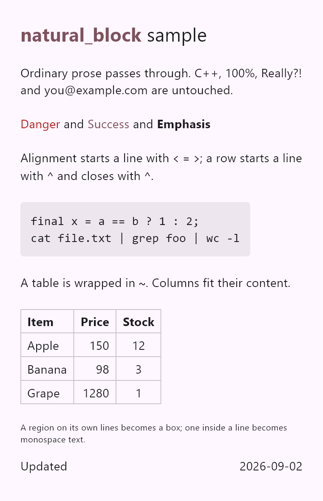

# natural_block_flutter

[English](README.md)

普通の文章をそのまま通す軽量マークアップ言語
[natural_block](https://github.com/SugaiMasayoshi/natural_block) を描く、Flutter
のウィジェットです。ブロック、横並び、表、寄せ、意味に基づく装飾、コードが、
`Column`、`Row`、`Table`、選択できる `Text.rich` になり、アプリの配色に合わせて
描かれます。

構文は
[natural_block の README](https://github.com/SugaiMasayoshi/natural_block/blob/main/README.ja.md)
を見てください。

## 見え方

このソースは

```text
:++*%natural_block:: sample

Ordinary prose passes through. C++, 100%, Really?! and you@example.com are untouched.

:!Danger:! and :%Success:% and :*Emphasis:*

Alignment starts a line with `<` `=` `>`; a row starts a line with `^` and closes with `^`.

`
final x = a == b ? 1 : 2;
cat file.txt | grep foo | wc -l
`

A table is wrapped in `~`. Columns fit their content.

~
:*Item::^>:*Price::^=:*Stock::^
Apple^150^12^
Banana^98^3^
Grape^1280^1^
~

:-A region on its own lines becomes a box; one inside a line becomes monospace text.

^Updated^^>2026-09-02^
```

次のように描かれます。



## はじめに

```
flutter pub add natural_block_flutter
```

`natural_block` を再エクスポートしているので、1つの import でノードの型や
`SpanDecoration` も使えます。

## 使い方

```dart
import 'package:flutter/material.dart';
import 'package:natural_block_flutter/natural_block_flutter.dart';

class Example extends StatelessWidget {
  const Example({super.key});

  @override
  Widget build(BuildContext context) {
    return const NaturalBlockView(
      source: '=:++*見出し\n:!在庫切れ:! です\n^<品名^>価格^',
    );
  }
}
```

`NaturalBlockView` が受け取るもの：

- `source`：描くマークアップ。
- `theme`：`NaturalBlockTheme`。既定は `NaturalBlockTheme.fromContext(context)`
  で、明るいテーマでも暗いテーマでも、アプリの `ColorScheme` と文字の大きさに
  従います。
- `builders`：ノードの種類ごとに、描くウィジェットを差し替える
  `NaturalBlockBuilders`。
- `customs`：カスタムの区間（`:@...:@`）のハンドラ。既定は空なので、カスタムの
  区間は見た目が付くだけで、何も起きません。

`customs` と `builders` は `const` でなければなりません。そうでないとアナライザが
警告します。ハンドラとビルダはトップレベルの関数として書いてください。

ブロックやセルをまたいで文字を選択できるようにするには、ビューを
`SelectionArea` で包みます。

## テーマ

```dart
NaturalBlockView(
  source: source,
  theme: NaturalBlockTheme.fromContext(context, striped: true),
);
```

`fromContext` と `fromColorScheme` は、アプリから色を決めます。`striped: true`
にすると、表の行を罫線ではなく縞で分けます。それ以外は `copyWith` で変えるか、
コンストラクタで一から作ります。

| フィールド | 決めるもの |
|---|---|
| `base`、`negative`、`positive`、`emphasis`、`custom` | 装飾ごとの文字のスタイル |
| `baseFontSize`、`fontSizeStep`、`minFontSize` | `:+` / `:-` の1段の大きさ |
| `tableCellPadding`、`tableBorder`、`tableStripe` | 表 |
| `raw`、`rawPadding`、`rawDecoration`、`rawScrollsHorizontally` | コードの区間 |

`styleFor(decoration, baseSize: ...)` は、区間を描くときのスタイルを返します。
罫線や枠を消すには、`const TableBorder()` や `const BoxDecoration()` を渡します。

## カスタムの区間

パーサは区間にカスタムの印を付けるだけです。文字がそのまま中身で、それが何を
意味するかはハンドラが決めます。各区間は `customs` のハンドラに順に渡され、
ハンドラは `null` を返して見送れます。

### タップできる文字

```dart
RunRendering? links(CustomRun run) {
  if (!run.text.startsWith('https://')) return null;
  return tappableText(
    run,
    onTap: (context) {
      // 例：url_launcher で launchUrl(Uri.parse(run.text))。
    },
  );
}

NaturalBlockView(source: source, customs: const [links]);
```

`onTap` は、タップした時点のその行の `BuildContext` を受け取ります。

### 自分で作る span

ハンドラは、行に入れる span と、その span が持つものを解放する `dispose` を
返します。

```dart
RunRendering? mentions(CustomRun run) {
  if (!run.text.startsWith('@')) return null;

  final recognizer = TapGestureRecognizer()
    ..onTap = () => run.withContext((context) => openProfile(context, run.text));
  return (
    span: TextSpan(text: run.text, style: run.style, recognizer: recognizer),
    dispose: recognizer.dispose,
  );
}
```

- `dispose` は必須です。作った recognizer はすべてここで解放し、解放するものが
  なければ `() {}` を渡します。
- `widgetRun(child)` は、行の中にウィジェットを、文字の高さの中央に揃えて
  描きます。child には有限の高さを与えてください。
- `run.style` は、その区間が本来描かれるはずだったスタイルです。
  `run.decoration` は、ソースにその区間について書かれていたことです。
- `run.withContext` は、タップのような後の時点で、その行の `BuildContext` を
  渡します。描いている最中に呼ぶと assert で止まります。

### 画像

画像は、中身が `image(<url>)` のカスタムの区間として書きます。

```dart
NaturalBlockView(
  source: ':@image(https://example.com/a.png):@',
  customs: const [NaturalBlockImages.network],
);
```

- `NaturalBlockImages.network` は、ネットワークの URL を描きます。入れるまでは
  無効です。外部の画像を描くと、文書が開かれたことが第三者に伝わるからです。
- `NaturalBlockImages.local` は、手元のファイルを描きます。Web では見送ります。
  読み手のマシンのファイルを指してよいと信頼できる文書にだけ入れてください。
- Windows のパスはスラッシュで書きます：`image(C:/Users/you/a.png)`
- 相対パスは、どちらも見送ります。解決するには、自分のハンドラを前に置きます。

  ```dart
  RunRendering? assets(CustomRun run) {
    final source = NaturalBlockImages.sourceOf(run.text);
    if (source == null ||
        NaturalBlockImages.kindOf(source) != ImageSourceKind.relative) {
      return null;
    }
    return widgetRun(Image.asset(source));
  }
  ```

- `NaturalBlockImages.scaleOf(run)` は、その区間の `:+` / `:-` の段に従います。

### 中身の慣習

決まりではなく、慣習です。

| 文字 | 意味 |
|---|---|
| `https://...` | 外部の URL |
| `#name` | 同じ文書の中の行き先 |
| `path#name` | 別の文書の中の行き先 |
| `@name` | メンション |
| `image(<url>)` | 画像 |

中身は人が読める形にしておいてください。それを知らないアプリでも、文字として
表示されます。

引数を取る中身を自分で作るときは、`image(...)` と同じ形にします。
`payloadArgument(run.text, 'note')` は `note(...)` の括弧の中を返し、そうでない
区間なら null を返します。ハンドラの中でも、木から拾った文字にも使えます。

## ビルダ

`NaturalBlockBuilders` は、ノードの種類ごとに1つのビルダを持ちます：`row`、
`column`、`table`、`tableCell`、`text`、`raw`。それぞれの既定は、その種類を
いつもどおりに描くものなので、変えるものだけを指定します。

```dart
Widget spacedText(TextNode node, NaturalBlockScope scope) => Padding(
  padding: const EdgeInsets.only(bottom: 8),
  child: buildTextNode(node, scope),
);

const builders = NaturalBlockBuilders(text: spacedText);
```

- 既定のビルダとそのウィジェットは、処理を任せたり再利用したりできるよう公開して
  います。
  - ビルダ: `buildRowNode`、`buildColumnNode`、`buildTableNode`、
    `buildTableCellNode`、`buildTextNode`、`buildRawNode`
  - ウィジェット: `RowNodeView`、`ColumnNodeView`、`TableNodeView`、
    `TextNodeView`、`RawNodeView`
- 子へは `buildLayouts(node.children, scope)` か
  `buildContents(node.children, scope)` で再帰してください。同じテーマ、
  ビルダ、ハンドラが引き継がれます。
- ビルダは `BuildContext` を受け取りません。InheritedWidget を読むには
  `Builder` を返してください。それが変わったとき、Flutter はその部分だけを
  描き直します。

## 制限

- 横スクロールのビューの中のように幅に上限がない場所では、横並びのセルは中身の
  幅に縮みます。列が揃わなくなり、寄せの記号も効きません。
- 表は、スクリーンリーダー向けの行と列の情報をまだ持っていません。
- ウィジェットとして描いた区間は、そのウィジェットが文字を持っていない限り、
  選択してコピーしても何も入りません。

## そのほかの情報

- バグの報告と要望：
  [GitHub issues](https://github.com/SugaiMasayoshi/natural_block_flutter/issues)
- なぜこう作られているか：[doc/design.md](doc/design.md)
